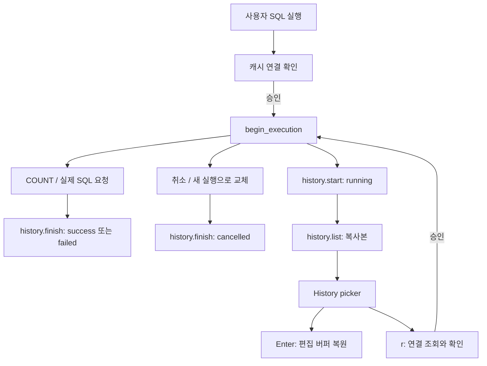

# 쿼리 히스토리 구현 작업 기록

작성일: 2026-11-08 · 작업 브랜치: `feat/query-history`

이 문서는 이번 변경을 이해하기 위한 코드 설명이다. 호출 흐름은 현재 소스를 정적으로
읽어 정리했고, 검증 항목은 기존에 실행한 Neovim/Plenary 테스트를 기준으로 구분했다.
스니펫은 실제 코드의 발췌이며, 서로 떨어진 코드를 합친 경우 별도로 표시했다.

## 목표와 사용자 동작

사용자가 실행한 SQL을 세션 안에서 찾아보고 수정하거나, 원래 연결에 다시 실행한다.
기본 보관량은 최근 100개이며 디스크 영구 저장은 구현하지 않았다.

| 조작                         | 동작                                                |
| ---------------------------- | --------------------------------------------------- |
| `<leader>sh`                 | SQL 관련 버퍼의 normal mode에서 히스토리 열기       |
| `:SQLFlickHistory`           | 명령으로 히스토리 열기                              |
| 검색창 입력                  | SQL과 연결 표시명·DB 이름을 대소문자 구분 없이 검색 |
| `<C-n>` / `<C-p>`            | 선택 이동                                           |
| 목록의 normal-mode `j` / `k` | 선택 이동                                           |
| Enter                        | SQL을 편집 가능한 새 버퍼로 복원                    |
| normal-mode `r`              | 원래 연결을 조회하고 확인 후 재실행                 |
| insert-mode Esc              | 창을 유지하고 normal mode로 전환                    |
| normal-mode Esc / `q`        | 창 닫기                                             |

Enter는 현재 선택 DB를 바꾸지 않는다. `r`은 현재 선택 DB와 관계없이 히스토리에
남은 연결 ID로 실행 대상을 찾는다. 이 차이가 두 동작을 이해하는 출발점이다.

## 파일별 역할과 전체 흐름

| 파일                                                     | 책임                                                |
| -------------------------------------------------------- | --------------------------------------------------- |
| [history.lua](../lua/sqlflick/history.lua)               | 메모리 기록, 개수 제한, 상태와 소요 시간            |
| [init.lua](../lua/sqlflick/init.lua)                     | 실행·취소·완료 시점 연결, 명령과 키맵, 재실행 판단  |
| [picker.lua](../lua/sqlflick/picker.lua)                 | 검색·선택·미리보기·키맵·창 정리                     |
| [history_picker.lua](../lua/sqlflick/history_picker.lua) | 히스토리를 목록/SQL 미리보기로 변환하고 버퍼에 복원 |
| [selector.lua](../lua/sqlflick/selector.lua)             | 기존 검색창·목록·미리보기 3개 floating window 생성  |
| [config.lua](../lua/sqlflick/config.lua)                 | `history.enabled`, `history.max_entries` 기본값     |

`picker.lua`는 콜백으로 내용을 받지만, 현재 사용하는 곳은 히스토리다. 기존 DB
selector의 동작 전체를 이 모듈로 옮긴 것은 아니고 **창 배치 생성 함수를 재사용**한다.



## 1. 기록을 만들고 보관하기

호출 경로: `init.lua:136 begin_execution()` → `history.lua:13 start()`.
실행 함수가 사용할 DB 설정에서 필요한 필드만 새 테이블로 골라 담는다.

`lua/sqlflick/history.lua:17` 발췌:

```lua
local entry = {
  sql = sql,
  connection = { id = db.id or db.name, name = db.name or db.id or db.type, type = db.type, database = db.database },
  state = "running",
  started_at = os.time(),
}
table.insert(entries, 1, entry)
while #entries > limit do
  table.remove(entries)
end
-- Keep timing private and monotonic; no connection credentials are retained.
return { entry = entry, started = vim.uv.hrtime() }
```

`entries`는 모듈 내부의 배열이다. 첫 위치에 삽입해서 최신 항목이 위로 오고,
한도를 넘으면 배열 끝의 오래된 항목을 제거한다. 원본 `db`를 저장하지 않으므로
비밀번호·호스트·사용자명은 기록에 포함되지 않는다. SQL 본문에는 민감한 값이
있을 수 있고, 본문 자체를 마스킹하는 기능은 없다.

`start()`가 반환하는 값은 실행 코드가 보관하는 **내부 핸들**이다.
`entry`는 배열 안의 기록과 같은 테이블을 가리킨다. 따라서 나중에
`record.entry.state`를 수정하면 목록의 항목도 바뀐다.

`os.time()`은 사용자에게 보여줄 실행 시각이다. `vim.uv.hrtime()`은 소요 시간
측정용 단조 시계로, 시스템 시각이 바뀌어도 경과 시간을 측정할 수 있다.

외부 조회에는 원본 대신 복사본을 반환한다. UI에서 조회한 테이블을 바꿔도 내부
기록이 변하지 않는다.

`lua/sqlflick/history.lua:39`:

```lua
function M.list()
  return vim.deepcopy(entries)
end
```

`history.setup()`은 기본 한도 100을 적용한다. `enabled = false` 또는
`max_entries = 0`이면 기록을 비우고 이후 `start()`는 `nil`을 반환한다.

## 2. 내부 요청이 여러 개여도 한 번만 기록하기

호출 경로: SQL 명령 → `execute_query_text()` → `begin_execution()` → 비동기 요청.
캐시 연결 확인에서 거절하면 `begin_execution()`에 도달하지 않아서 기록도 없다.

`lua/sqlflick/init.lua:143`:

```lua
local execution = { query_text = query_text, database = db, refresh = refresh }
if not refresh then
  execution.history = history.start(query_text, db)
end
active_execution = execution
```

기록은 HTTP 요청이나 COUNT 함수마다 만들지 않고, 사용자 실행을 묶는
`execution`에 붙인다. 예를 들어 SELECT 한 번이 `COUNT → 첫 페이지 조회`로
나뉘어도 히스토리는 한 개다. `refresh = true`인 페이지 이동·새로고침은 새 기록을
만들지 않는다. 소요 시간에는 COUNT와 실제 SQL 요청이 함께 포함된다.

완료 경로: 비동기 콜백 → `init.lua:150 finish()` → `history.finish()`.

```lua
local function finish(result)
  if active_execution ~= execution then
    return
  end
  active_execution = nil
  history.finish(execution.history, result.error and "failed" or "success")
```

위 코드는 `finish()`의 앞부분이다. 현재 실행과 콜백의 `execution`이 같은지
먼저 확인한다. A를 취소하고 B를 실행한 뒤 A의 응답이 늦게 도착하더라도,
A가 B의 상태나 결과를 덮어쓰지 못하도록 하는 검사다.

취소 경로에서는 `active_execution`을 먼저 비우고 기록을 종료한 뒤 요청을 취소한다.
새 쿼리가 기존 쿼리를 교체할 때도 이 경로를 사용한다.

`lua/sqlflick/init.lua:116`:

```lua
active_execution = nil -- Invalidate callbacks before signalling the process.
history.finish(execution.history, "cancelled")
redraw_statusline()
if execution.request then
  execution.request:cancel()
end
```

마지막으로 `history.finish()`도 이미 끝난 항목을 다시 바꾸지 않게 방어한다.
기록 비활성화나 페이지 refresh로 핸들이 `nil`이어도 그대로 반환한다.

`lua/sqlflick/history.lua:31`:

```lua
function M.finish(record, state)
  if not record or record.entry.state ~= "running" then
    return
  end
  record.entry.state = state
  record.entry.duration_ms = math.floor((vim.uv.hrtime() - record.started) / 1000000)
end
```

## 3. 데이터를 검색·미리보기 UI에 연결하기

호출 경로: `:SQLFlickHistory` → `history_picker.open()` → `picker.open()` →
`selector.create_selector_window()`.

`history_picker.lua`가 내용을 제공하고 `picker.lua`가 창과 조작을 담당한다.
함수를 값으로 넘기는 **콜백** 구조이므로, picker는 히스토리 필드 이름을 몰라도 된다.

`lua/sqlflick/history_picker.lua`의 콜백 지정 부분 발췌:

```lua
items = history.list,
search = function(item) return target(item) .. " " .. item.sql end,
label = function(item)
  return icons[item.state] .. " " .. os.date("%H:%M", item.started_at) .. " " .. clean(item.sql)
end,
```

`items`는 현재 기록을 읽는 함수이고, `search`는 검색할 문자열,
`label`은 목록 한 줄을 만드는 함수다. `preview`는 메타데이터와 전체 SQL을
줄 배열로 반환한다. `clean()`은 목록/연결 표시용 제어 문자를 공백으로 바꾸며,
저장한 SQL 본문은 그대로 유지한다.

`picker.lua`의 `refresh()`는 검색어와 후보 문자열을 소문자로 바꾸고 비교한다.
핵심 조건은 다음과 같다.

```lua
if opts.search(item):lower():find(term, 1, true) then
  items[#items + 1] = item
  lines[#lines + 1] = opts.label(item)
end
```

`find(..., 1, true)`의 마지막 `true`는 Lua 패턴이 아닌 일반 문자열로 찾으라는
뜻이다. 예를 들어 `100%`나 `users[0]`을 입력해도 특수한 검색 문법으로 해석하지 않는다.
검색은 부분 문자열 비교이며 fuzzy 검색은 아니다.

`TextChanged`/`TextChangedI`가 검색을 갱신하고, 이동 키와 `CursorMoved`가
선택 위치와 preview를 맞춘다. 목록은 창을 열거나 검색어를 바꿀 때 갱신하며,
열린 상태의 실행 완료를 실시간 구독하는 구조는 아직 없다.

## 4. Enter 복원과 r 재실행

picker에서 동작을 고르면 `choose()`가 먼저 임시 창을 닫고 원래 창으로 돌아간 뒤
선택한 항목을 콜백에 넘긴다.

`lua/sqlflick/picker.lua`의 `choose()`:

```lua
local function choose(action)
  local item = items[index]
  if item then
    close()
    action(item)
  end
end
```

### Enter: 편집용 SQL 버퍼

경로: `choose(opts.accept)` → `history_picker.lua`의 `accept(item)`.

```lua
local buf = vim.api.nvim_create_buf(true, false)
vim.api.nvim_win_set_buf(0, buf)
vim.bo[buf].buftype = "nofile"
vim.bo[buf].bufhidden = "hide"
vim.bo[buf].swapfile = false
vim.api.nvim_buf_set_lines(buf, 0, -1, false, vim.split(item.sql, "\n", { plain = true }))
vim.bo[buf].filetype = "sql"
vim.b[buf].sqlflick_history_connection = item.connection.id
```

원래 파일에 덮어쓰지 않고 편집 가능한 새 버퍼에 SQL을 넣는다.
`nofile`은 일반 파일과 연결되지 않은 버퍼, `swapfile = false`는 swap 파일을
만들지 않는다는 뜻이다. `filetype = "sql"`을 지정하면 기존 SQL FileType
설정과 `<leader>sq`, `<leader>sh` 키맵을 적용받는다.

`sqlflick_history_connection`은 출처를 보관하는 버퍼 변수다. 현재 실행 경로가
이 변수를 읽어 DB를 자동 선택하지는 않는다. 실행하면 현재 선택 DB를 사용하므로,
복원 후 알림에 나온 원래 연결과 statusline을 확인해야 한다.

### r: 원래 연결에 확인 후 실행

경로: `choose(opts.replay)` → `init.lua:512`의 재실행 콜백.

```lua
local db = tree.find_database_by_id(config.opts.databases, item.connection.id)
if not db or db.type ~= item.connection.type or db.database ~= item.connection.database then
  vim.notify("Historical connection is missing, ambiguous, or changed. Restore and review the SQL instead.", vim.log.levels.WARN)
  return
end
```

연결 ID가 현재 설정에 정확히 하나 존재해야 하고, DB 종류와 database 값도
기록과 같아야 한다. 통과하면 대상과 SQL을 `vim.fn.confirm()`으로 보여준다.
기본 선택은 Quit이며, Run 승인 후 기존 실행 파이프라인으로 돌아간다.

```lua
result_context = nil
begin_execution(item.sql, db, config.opts.backend, false)
```

현재 선택 DB는 그대로 두고 `db` 인자로 실행 대상만 고정한다. 재실행도 새 사용자
실행이므로 새로운 히스토리 항목을 만든다. 호스트·포트는 기록하지 않기 때문에
같은 ID의 호스트·포트 변경까지 감지하지는 않는다. 실제 접속 설정은 현재 값을 쓴다.

## 5. 창과 버퍼 정리

경로: normal-mode Esc/q, Enter/r, picker 밖으로 이동, 창 닫힘 → `picker.lua`의 `close()`.
insert-mode Esc는 기본 Esc 동작으로 normal mode에 돌아오며 창을 닫지 않는다.

`closed` 플래그를 먼저 설정해 여러 종료 이벤트가 겹쳐도 한 번만 정리한다.
그다음 autocmd 그룹을 삭제하고 유효한 창과 버퍼만 닫은 뒤 원래 창으로 돌아간다.

`WinClosed`/`WinEnter` 콜백은 `vim.schedule()`로 현재 이벤트 처리가 끝난 뒤
창 상태를 확인한다. 창을 닫는 도중 또 다른 창 이벤트가 발생해도,
예약된 콜백은 `closed`를 보고 종료한다. preview/list/search 내부 이동은 허용하고
이 세 창 밖으로 이동하거나 하나가 닫히면 나머지도 정리한다.

## 6. 검증과 작업 상태

insert-mode Esc 동작 수정 후 `make test`로 전체 192개 테스트가 통과했다.
실제 키 입력으로 insert mode 진입 → Esc → 창 유지/normal mode 전환 →
Enter 복원·`r` 재실행·normal-mode Esc 종료 흐름도 확인했다.

| 파일                                                          | 이번 기능과 관련해 확인한 동작                                                   |
| ------------------------------------------------------------- | -------------------------------------------------------------------------------- |
| [history_spec.lua](../tests/history_spec.lua)                 | 최신순/개수 제한, 조회 복사본, 자격증명 제외, 종료 상태 중복 변경 방지, 비활성화 |
| [execution_async_spec.lua](../tests/execution_async_spec.lua) | COUNT/페이지 조회 묶음, refresh 중복 방지, 실패·취소, 확인 거절 시 미기록        |
| 같은 실행 테스트 파일                                         | SQL 복원 후 현재 선택 유지, `%` 일반 문자열 검색, 수락 후 창/버퍼 정리           |
| 같은 실행 테스트 파일                                         | insert-mode Esc 후 창 유지와 normal-mode Enter/r/Esc 동작                        |
| 같은 실행 테스트 파일                                         | 원래 연결로 재실행, 확인 기본값 Quit, 확인 거절·연결 삭제 시 실행 차단           |

실제 DB를 붙여 히스토리 동작을 검증한 결과는 이 문서에 포함하지 않았다.
위 실행 테스트는 전송 응답을 제어하는 모의 transport와 실제 Neovim 창·버퍼·명령을 사용한다.
현재 변경은 커밋 전 상태다.
